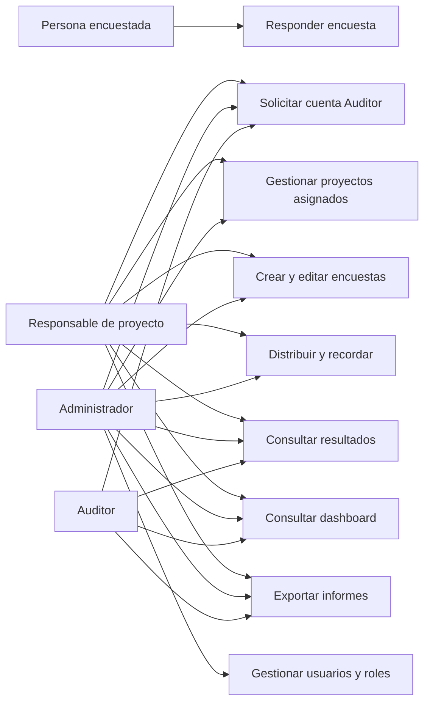
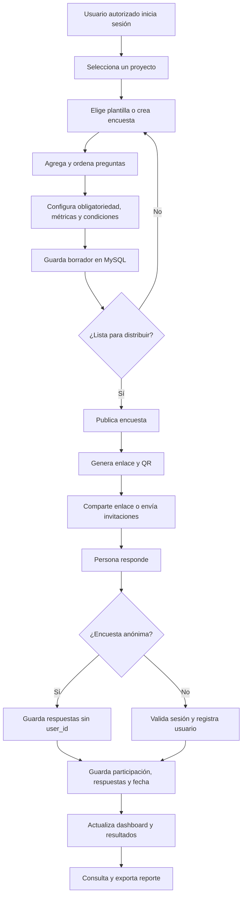
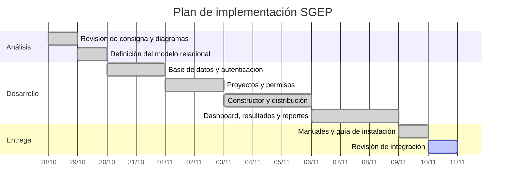
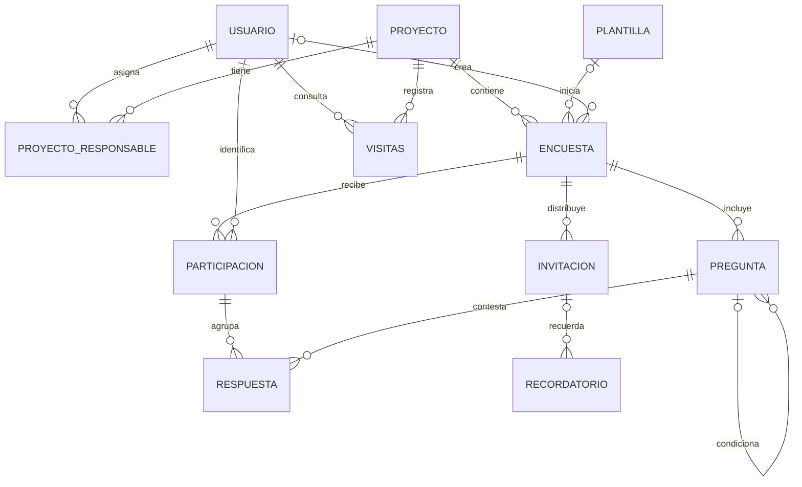

# Diagramas SGEP

## Casos de uso y permisos

El diagrama inicial se complementa con Auditor, que aparece en la consigna. La persona encuestada puede responder sin cuenta; el alta de una cuenta administrativa se asigna como Auditor inactivo hasta habilitación.

## Flujo de publicación y respuesta

## Cronograma de referencia

## Relaciones del modelo

